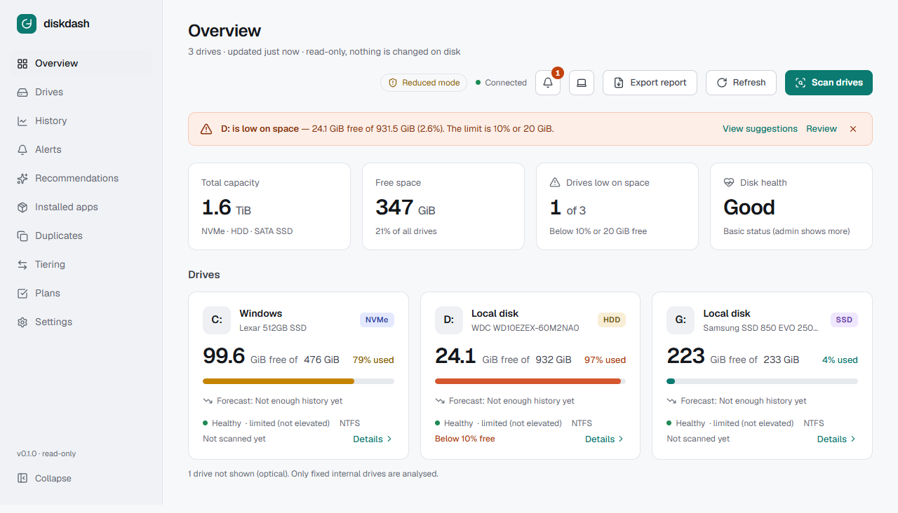
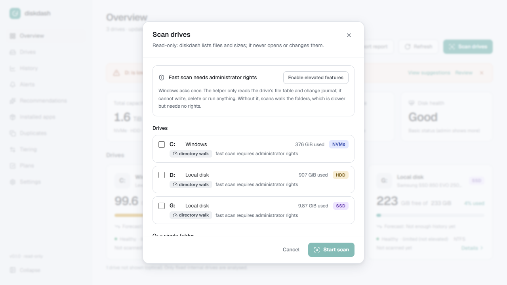
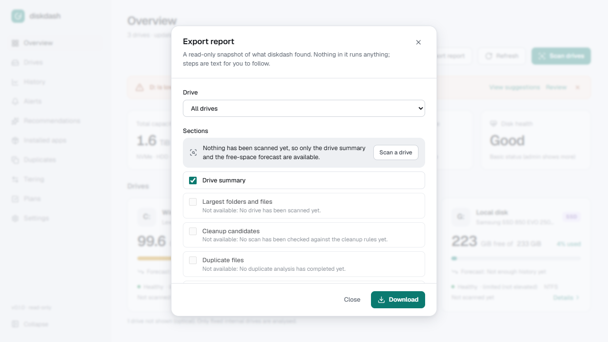

# diskdash

**A local, read-only dashboard that shows where the space on your Windows drives went, and what you could safely remove or move.**

[](https://github.com/michael-stanin/diskdash/actions/workflows/ci.yml)
[](LICENSE)




diskdash scans the fixed internal drives of one PC (HDDs, SATA SSDs, NVMe), then tells you what is big, what is old, what is duplicated and what could be cleaned, with the exact manual steps. **It never deletes, moves or changes anything.** You do every step yourself.

- **Private by design.** It listens on `127.0.0.1` only, makes no outbound connections, has no accounts and no telemetry, and shows no Windows notifications.
- **One portable folder.** Unzip and run. No installer, no service, no scheduled task, nothing running in the background.
- **Fast when you let it.** An optional, strictly read-only elevated helper reads the NTFS file table, so a whole-drive scan takes seconds instead of minutes. Decline the Windows prompt and everything still works with the normal folder walk.

## Features

| | |
|---|---|
| **Drives** | Capacity, free space, media type (HDD / SATA SSD / NVMe), health, TRIM, low-space warnings, free-space forecast. |
| **Usage explorer** | Treemap and sunburst of any folder, largest files and folders, file-type breakdown, hard links counted once, junctions never followed. |
| **Cleanup suggestions** | 48 rules for caches, temp files, update leftovers, developer folders and more, ranked by space freed vs. risk (Safe / Review / Expert), each with copyable manual steps. |
| **Stale data** | Files and folders you have not used for months, honest about whether Windows records last-access times. |
| **Duplicates** | Finds identical files (size, then partial, then full BLAKE3 hash) and near-duplicate folders, with keep-rule suggestions. |
| **Installed apps** | Largest programs and when they last ran, linked to Windows Settings for uninstalling. |
| **Tiering** | Suggests what to move from a full SSD to an HDD (cold data), or from an HDD to an SSD (hot data and game libraries), and what it would do to free space. |
| **Cleanup plans** | Collect suggestions into a checklist, export it, then re-scan to verify how much you really freed. |
| **History** | Compare any two scans (what grew, shrank, appeared), free-space trend and "days until full" with an honest confidence note. |
| **Alerts** | Low space and fast-growing folders, shown inside the app only, with de-duplication and cooldown. |
| **Reports** | Export HTML (self-contained, works offline), CSV (zipped) or JSON. |

| Scan dialog and fast scan | Export a report |
|---|---|
|  |  |

A dark theme is included and follows your system setting.

## Download and run

1. Get the latest `diskdash-<version>-windows-x64.zip` from the [Releases](https://github.com/michael-stanin/diskdash/releases) page.
2. Optional: check it against the `.sha256` file next to it:
   ```powershell
   (Get-FileHash .\diskdash-<version>-windows-x64.zip -Algorithm SHA256).Hash.ToLower()
   ```
3. Unzip anywhere and double-click **Start diskdash.cmd**. Your browser opens on <http://127.0.0.1:8765>.
4. Closing the browser tab does not stop it. To reopen the page, double-click **Start diskdash.cmd** again (it opens the running copy) or go to <http://127.0.0.1:8765>. To stop it, close the window or press Ctrl+C.

> **SmartScreen warning.** The binaries are not code-signed (a certificate costs money), so Windows may say "unrecognised app". Choose *More info*, then *Run anyway* if you trust the source, or build from source below and compare.

Your scan results, settings and logs live in `%LOCALAPPDATA%\diskdash`. Delete that folder to start fresh. Use `diskdash.exe --port 9000` to change the port.

## Is it safe?

diskdash is built around one rule: **it must never be able to lose your data.** This is enforced in the code base, not just promised:

- **No write path to your files.** Clippy forbids file-mutating `std::fs` calls outside one audited module, and `cargo xtask readonly-check` fails the build if any Win32 delete/move/write API appears. The only files it writes are its own database and logs, and a report you explicitly export (new file only, never overwriting).
- **No network.** It binds to loopback only, rejects cross-origin requests, uses a per-session token for state-changing calls, and `cargo xtask no-http-client` fails the build if an HTTP client is ever added.
- **No OS integration.** `cargo xtask no-os-integration` fails the build on notifications, tray icons, shortcuts, services or scheduled tasks.
- **A helper that can only read.** The elevated helper exposes a closed set of read-only operations over a named pipe that only your user can open, authenticated with a per-launch secret. It takes volume IDs it listed itself, never paths, and has no write, delete or run operation.
- **Suggestions, not actions.** Protected locations (Windows, Program Files and other system folders, plus anything you add in Settings) are never suggested. Instructions are shown as text and never executed.

See [SECURITY.md](SECURITY.md) for how to report a problem.

## Requirements

- Windows 10 or 11, x64.
- A modern browser (Edge, Chrome, Firefox).
- To build from source: Rust (stable, MSVC toolchain) with the Visual C++ build tools, and Node.js 20 or newer.

Only fixed internal drives are analysed. USB, optical, virtual and network drives are deliberately out of scope.

## Build from source

```bash
git clone https://github.com/michael-stanin/diskdash.git
cd diskdash
.\start.cmd            # builds if needed, starts on http://127.0.0.1:8765, opens the browser
```

`start.cmd` runs `start.ps1` with the execution policy bypassed for that one script only; no system setting is changed. Options: `-Port 9000`, `-NoBrowser`, `-Dev` (backend plus Vite dev server with hot reload on <http://127.0.0.1:5173>).

To make the portable zip (UI, release binaries, helper, README, smoke test, SHA-256):

```bash
cd frontend && npm ci && cd ..
cargo xtask package
```

The result is in `dist\`.

## Develop

| Check | Command |
|---|---|
| Rust tests (also regenerate `frontend/src/api/types`) | `cargo test --workspace` |
| Formatting | `cargo fmt --all -- --check` |
| Lints, including the read-only list | `cargo clippy --workspace --all-targets -- -D warnings` |
| Win32 read-only guard | `cargo xtask readonly-check` |
| No HTTP client in the server | `cargo xtask no-http-client` |
| No OS notifications, trays, services, tasks | `cargo xtask no-os-integration` |
| UI lint, types, unit tests | `npm run lint`, `npm run typecheck`, `npm test` (in `frontend/`) |
| No external URLs in the UI bundle | `npm run build && npm run check:bundle` |
| End-to-end, both themes and contrast | `npx playwright test` (uses the installed Microsoft Edge) |
| Opt-in admin tests (VHDX, MFT vs. walk) | `DISKDASH_ADMIN_TESTS=1 cargo test -p diskdash-core --test admin_ntfs -- --ignored` (elevated) |

### Architecture

A Rust cargo workspace that produces `diskdash.exe` (the UI is embedded) and `diskdash-helper.exe`:

| Crate | Role |
|---|---|
| `diskdash` | axum server, job runner, SSE, all HTTP routes, report and alert services |
| `diskdash-core` | Directory-walk scanner, NTFS MFT parser and importer, snapshot schema |
| `diskdash-analysis` | Rules engine, stale data, duplicates, tiering, forecast, alerts (pure logic) |
| `diskdash-inventory` | Drive, health and installed-app discovery |
| `diskdash-store` | SQLite catalog and migrations; the single allow-listed file writer |
| `diskdash-helper` | The strictly read-only elevated helper and its protocol |
| `test-fixtures` | Builds temporary trees and test VHDX volumes |
| `xtask` | Repository guards and packaging |

The frontend (`frontend/`) is React 19, TypeScript, Vite, Tailwind, Radix UI, TanStack Query/Table/Virtual and Apache ECharts, with shared TypeScript API types generated from the Rust structs.

The project is spec-driven with [OpenSpec](https://github.com/Fission-AI/OpenSpec): the requirements live in `openspec/specs/`, and every completed change is archived with its design and tasks in `openspec/changes/archive/`.

## Limitations

- Windows x64 only; no Linux or macOS support (it reads the machine through Windows APIs).
- Unsigned binaries.
- The fast MFT scan and USN quick rescan are tested against synthetic volumes and in-process fakes. The test against a real volume needs an elevated opt-in run (see above); treat the fast scan as **experimental** until it has had wider use, and tell us what you see.
- Allocated-size accounting for OneDrive placeholders, dedup and WOF-compressed files follows the documented rules but cannot be exact in every case.

## Contributing

Bug reports, ideas and pull requests are welcome. Please read [CONTRIBUTING.md](CONTRIBUTING.md) first, in particular the safety rules, which every change must keep. By taking part you agree to the [Code of Conduct](CODE_OF_CONDUCT.md).

## License

[MIT](LICENSE). Third-party components and their licenses are listed in [THIRD_PARTY_NOTICES.md](THIRD_PARTY_NOTICES.md).
